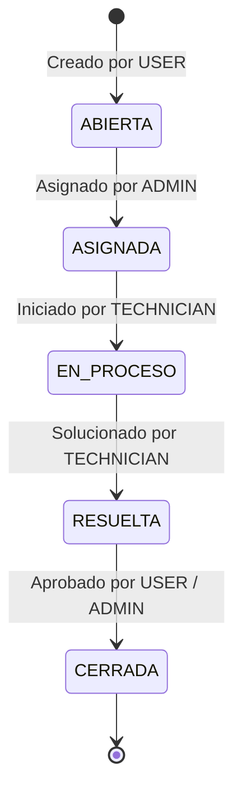

# TechNova IT Helpdesk

> **Sistema Integral de Gestión de Incidencias, Control de SLA y Soporte Técnico TI**

<p align="left">
  
  
  
  
  
  
  
  
  
  
</p>

---

## 1. Contexto del Proyecto

**TechNova IT Helpdesk** es una plataforma web centralizada diseñada para optimizar y formalizar la atención de solicitudes de soporte técnico en **TechNova Solutions**.

* **Problema que resuelve:** Elimina la dispersión e informalidad en el registro de incidencias (canales informales como correos o mensajería sin trazabilidad), evitando pérdida de solicitudes, demoras no controladas y ausencia de métricas operativas.
* **Solución técnica:** Implementa un flujo estricto gobernado por una **máquina de estados**, control de tiempos de atención basados en **SLA por prioridad**, asignación supervisada por administradores, auditoría completa e integración con dashboards analíticos.

---

## 2. Tecnologías y Versiones

| Capa / Módulo     | Tecnología / Herramienta                                                                                                                                                                                                                                                                                                                                                                                                 | Versión    | Propósito                                                            |
|:----------------- |:------------------------------------------------------------------------------------------------------------------------------------------------------------------------------------------------------------------------------------------------------------------------------------------------------------------------------------------------------------------------------------------------------------------------ |:---------- |:-------------------------------------------------------------------- |
| **Lenguaje**      |  **Java**                                                                                                                                                                                                                                                                                    | `21 (LTS)` | Lenguaje backend principal con soporte para Virtual Threads.         |
| **Framework**     |  **Spring Boot**                                                                                                                                                                                                                                                            | `4.1.1`    | Core de la aplicación, configuración e inyección de dependencias.    |
| **Seguridad**     |  **Spring Security** +  **JJWT**                                                                                                | `0.12.6`   | Autenticación stateless mediante tokens JWT y control RBAC.          |
| **Persistencia**  |  **Spring Data JPA** / **Hibernate**                                                                                                                                                                                                                                             | Integrada  | Mapeo objeto-relacional y consultas optimizadas.                     |
| **Base de Datos** |  **PostgreSQL**                                                                                                                                                                                                                                                               | `15+`      | Motor de base de datos relacional con índices y restricciones.       |
| **Build Tool**    |  **Gradle** (Wrapper)                                                                                                                                                                                                                                                                     | `9.7.1`    | Automatización de compilación y gestión de dependencias.             |
| **Documentación** |  **SpringDoc OpenAPI**                                                                                                                                                                                                                                                                 | `2.8.5`    | Documentación interactiva Swagger UI y especificación OpenAPI 3.     |
| **Frontend**      |   **Lumina Desk (Tailwind + ES6 Modules)** | `2.0 (Lumina)` | Nueva suite de Front-end basada en tokens Lumina Support, modular y conectada a la API REST. |

---

## 3. Credenciales de Prueba

La base de datos cuenta con cuentas semilla preconfiguradas con contraseñas encriptadas en **BCrypt** (`admin123`):

| Rol            | Correo Electrónico     | Contraseña | Alcance y Permisos                                                                               |
|:-------------- |:---------------------- |:---------- |:------------------------------------------------------------------------------------------------ |
| **ADMIN**      | `admin@technova.com`   | `admin123` | Control total del sistema, asignación manual de tickets a técnicos, métricas y dashboard global. |
| **TECHNICIAN** | `tecnico@technova.com` | `admin123` | Gestión de tickets asignados, avance de estados operativos y comentarios técnicos.               |
| **USER**       | `usuario@technova.com` | `admin123` | Creación de incidencias, seguimiento de solicitudes propias y confirmación de cierre.            |

---

## 4. Entidades Principales

El modelo de datos se estructura en torno a las siguientes entidades clave:

```
[UserAccount] 1 ──── * [Ticket] * ──── 1 [Category]
      │                   │ *
      │                   ├──── 1 [Priority]
      │ *                 ├──── 1 [TicketStatus]
[UserRole]                ├──── * [Comment]
      │ *                 ├──── * [TicketAssignment]
    [Role]                └──── * [TicketHistory]
```

* **`UserAccount`**: Representa a los usuarios del sistema (nombre, apellido, email único, password hash, estado activo).
* **`Role` y `Permission`**: Modelo RBAC con relación N:M para control granular de privilegios.
* **`Ticket`**: Entidad central con título, descripción, solicitante, categoría, prioridad y estado actual.
* **`Category`**: Clasificación del incidente (`HARDWARE`, `SOFTWARE`, `REDES`, `ACCESOS`, `OTROS`).
* **`Priority`**: Nivel de criticidad (`BAJA`, `MEDIA`, `ALTA`, `CRITICA`) asociado al tiempo de SLA.
* **`TicketStatus` y `StatusTransition`**: Catálogo de estados y matriz relacional que valida qué transiciones están permitidas.
* **`TicketAssignment`**: Registro histórico de asignaciones de técnicos a tickets con fecha y asignador.
* **`Comment`**: Hilo de retroalimentación bidireccional entre usuario y técnico dentro del ticket.
* **`TicketHistory`**: Registro inmutable de auditoría para cada cambio de estado, autor y marca de tiempo.

---

## 5. Flujo del Ciclo de Vida y SLAs

### Máquina de Estados Estricta

El ciclo de vida del ticket no permite saltos arbitrarios de estado:



### Tiempos Máximos de SLA por Prioridad

* **CRÍTICA:** SLA máximo de **1 hora** (incidentes que paralizan la operación).
* **ALTA:** SLA máximo de **2 horas** (impacto severo en procesos clave).
* **MEDIA:** SLA máximo de **8 horas** (afectación parcial operativa).
* **BAJA:** SLA máximo de **24 horas** (consultas o fallas menores).

---

## 6. Documentación de la API (Swagger UI)

Una vez iniciado el servidor backend, la interfaz interactiva de Swagger UI y la especificación OpenAPI están disponibles de forma pública en:

* **Swagger UI (Interactivo):** [http://localhost:8080/swagger-ui/index.html](http://localhost:8080/swagger-ui/index.html)
* **OpenAPI Docs (JSON):** [http://localhost:8080/v3/api-docs](http://localhost:8080/v3/api-docs)

> **Instrucciones para probar endpoints protegidos en Swagger:**
> 
> 1. Realizar una petición `POST /api/auth/login` con cualquiera de las credenciales de prueba.
> 2. Copiar el valor del `token` devuelto en el JSON de respuesta.
> 3. Hacer clic en el botón **Authorize** (esquina superior derecha en Swagger UI) e ingresar: `Bearer <tu_token>`.

---

## 7. Carga y Ejecución del Proyecto

### Prerrequisitos

* **Java 21 JDK** instalado y configurado en variables de entorno (`JAVA_HOME`).
* **PostgreSQL 15+** en ejecución local o remota.
* Navegador web moderno con soporte JavaScript ES6+.

---

### Paso 1: Configurar la Base de Datos PostgreSQL

1. Acceder al gestor PostgreSQL (`psql`, pgAdmin o DBeaver) y crear la base de datos:
   
   ```sql
   CREATE DATABASE "TechNovaTest";
   ```
2. Ejecutar el script DDL y DML semilla ubicado en:
   
   ```text
   project/src/main/resources/technova_schema_and_data.sql
   ```
   
   *(Este script inicializa el esquema, índices, roles, permisos y los usuarios de prueba con sus contraseñas encriptadas).*

---

### Paso 2: Ejecutar el Backend (Spring Boot)

1. Abrir una terminal en el directorio `project`:
   
   ```bash
   cd project
   ```
2. Si PostgreSQL utiliza credenciales distintas a las predeterminadas (`admin` / `admin123`), ajustar las variables de entorno o editar `src/main/resources/application.yaml`:
   
   ```yaml
   spring:
     datasource:
       url: jdbc:postgresql://localhost:5432/TechNovaTest
       username: tu_usuario
       password: tu_password
   ```
3. Compilar y ejecutar la aplicación mediante Gradle Wrapper:
   * **Windows (PowerShell / CMD):**
     
     ```powershell
     .\gradlew.bat bootRun
     ```
   * **Linux / macOS:**
     
     ```bash
     ./gradlew bootRun
     ```
4. El backend iniciará en el puerto `8080` (`http://localhost:8080`).

---

### Paso 3: Ejecutar el Frontend

El frontend está implementado en **Vanilla JavaScript** y HTML5 puro, por lo que no requiere instalación de dependencias ni procesos de compilación:

* **Opción A (VS Code Live Server):** Abrir la carpeta `frontend/` y seleccionar `index.html` > *Open with Live Server*.
* **Opción B (Python HTTP Server):**
  
  ```bash
  cd frontend
  python -m http.server 3000
  ```
  
  Abrir en el navegador: `http://localhost:3000`.
* **Opción C (Node.js serve):**
  
  ```bash
  npx serve frontend -p 3000
  ```

---

## 8. Endpoints Principales de la API

| Método  | Endpoint                     | Acceso Requerido                | Descripción                                                               |
|:-------:|:---------------------------- |:-------------------------------:|:------------------------------------------------------------------------- |
| `POST`  | `/api/auth/login`            | Público                         | Autenticación y generación de token JWT.                                  |
| `GET`   | `/api/tickets`               | Autenticado                     | Listar tickets con filtros (USER consulta propios, ADMIN consulta todos). |
| `POST`  | `/api/tickets`               | `USER` / `ADMIN`                | Creación de una nueva solicitud de soporte.                               |
| `GET`   | `/api/tickets/{id}`          | Autenticado                     | Detalle completo de un ticket con historial y comentarios.                |
| `PUT`   | `/api/tickets/{id}/assign`   | `ADMIN`                         | Asignación o reasignación manual de técnico.                              |
| `PATCH` | `/api/tickets/{id}/status`   | `TECHNICIAN` / `ADMIN` / `USER` | Cambio de estado controlado por la máquina de estados.                    |
| `POST`  | `/api/tickets/{id}/comments` | Autenticado                     | Registro de comentarios y notas de seguimiento en el ticket.              |
| `GET`   | `/api/admin/dashboard`       | `ADMIN`                         | Métricas operativas, conteo por estado, SLA y carga de trabajo.           |
| `GET`   | `/api/categories`            | Autenticado                     | Consulta del catálogo de categorías activas.                              |
| `GET`   | `/api/priorities`            | Autenticado                     | Consulta del catálogo de prioridades y niveles de SLA.                    |

---

## 9. Estructura del Repositorio

```text
TechNova-IT-Helpdesk/
├── frontend/                     # Aplicación web Vanilla JS (SPA)
│   ├── css/styles.css            # Estilos globales y diseño responsivo
│   ├── js/                       # Módulos JS (api.js, session.js, ui.js, auth.js, etc.)
│   ├── index.html                # Página de inicio de sesión
│   ├── tickets.html              # Listado y gestión de solicitudes
│   ├── ticket-detail.html        # Detalle de ticket, comentarios y transiciones
│   ├── dashboard.html            # Panel de métricas y analítica
│   └── admin.html                # Panel administrativo y asignación
├── project/                      # Backend Spring Boot (Java 21)
│   ├── src/main/java/tech/com/project/
│   │   ├── controller/           # Controladores REST API
│   │   ├── model/                # Entidades JPA del dominio
│   │   ├── repository/           # Repositorios Spring Data JPA
│   │   ├── security/             # Configuración JWT y Spring Security
│   │   └── service/              # Lógica de negocio y máquina de estados
│   ├── src/main/resources/
│   │   ├── application.yaml      # Configuración de propiedades y datasource
│   │   └── technova_schema_and_data.sql # Script SQL inicial (DDL + Semilla)
│   ├── build.gradle              # Dependencias y configuración Gradle
│   └── gradlew / gradlew.bat     # Wrapper de Gradle
├── media/                        # Capturas y evidencias visuales del proyecto
├── ERS TechNova.md               # Especificación de Requisitos de Software formal
└── README.md                     # Documentación principal simplificada del proyecto
```

---

## Equipo y Créditos

* **Desarrollo y Arquitectura:** Santiago Andrés Sarmiento Martínez
* **Front-end:** Fabio Daniel Capacho Nuñez
* **Desarrollo de API y Conección:** Jaon Ferney Pallares Duque y Brayan Fonxeca
* **Organización:** TechNova Solutions
