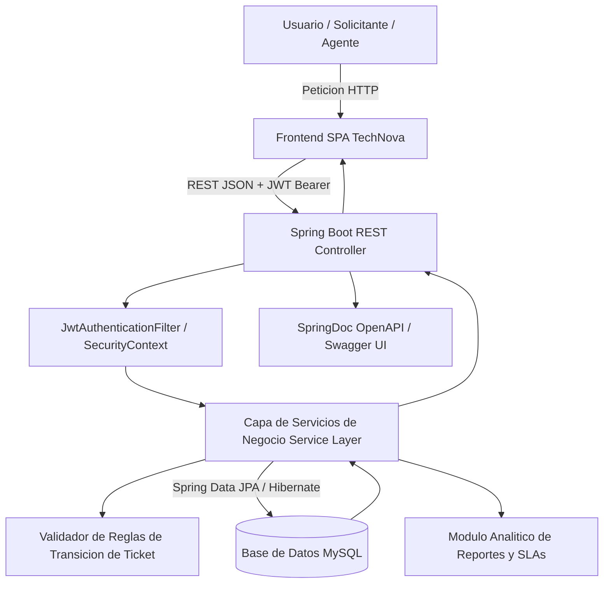

# TechNova - Sistema Integral de Mesa de Ayuda y Gestion de Tickets Empresariales

Plataforma corporativa de nivel empresarial para la recepcion, clasificacion, resolucion y auditoria de tickets de soporte tecnico y servicios de tecnologia.

[]()
[]()
[]()
[]()
[]()

## Resumen Ejecutivo

En entornos corporativos medianos y grandes, la falta de trazabilidad en solicitudes de soporte ocasiona incumplimientos de acuerdos de nivel de servicio (SLA), duplicidad de esfuerzos y perdida de visibilidad sobre problemas recurrentes en infraestructura. TechNova proporciona una solucion centralizada y escalable construida sobre Spring Boot 4 y MySQL, permitiendo a las organizaciones canalizar solicitudes, asignar prioridades dinamicas y emitir reportes de desempeno de equipos de soporte.

## Alcance y Objetivos de Negocio

- Registro y ciclo de vida de tickets de soporte (Abierto, Asignado, En Analisis, En Espera de Proveedor, Resuelto, Cerrado).
- Gestion de acuerdos de nivel de servicio (SLA) categorizados por impacto y urgencia.
- Seguridad perimetral robusta con autenticacion JWT y control de acceso basado en roles (Admin, Agente Tecnico, Empleado Solicitante).
- Generacion de metricas operativas, tiempos de primera respuesta y resolucion en modulo de reportes analiticos.
- Documentacion y pruebas estandarizadas de endpoints mediante archivos `.http` y Swagger UI.

## Arquitectura del Sistema

TechNova esta disenado bajo los principios de la Arquitectura Limpia y el patron por Capas de Spring Boot:
1. Capa de Controladores REST (`project/src/.../controller`):
   Expone contratos HTTP, valida datos de entrada con Bean Validation (`@Valid`) y gestiona codigos de estado.
2. Capa de Seguridad y Filtros (`security/`):
   Intercepta cabeceras `Authorization: Bearer <token>`, valida firmas JWT y establece el contexto de seguridad.
3. Capa de Servicios de Negocio (`service/`):
   Implementa la logica transaccional (`@Transactional`), control de SLAs y reglas de transicion de estados.
4. Capa de Repositorios y Persistencia (`repository/`):
   Abstraccion JPA / Hibernate conectada a motor relacional MySQL.
5. Capa Frontend Desacoplada (`frontend/`):
   Interfaz moderna SPA en JavaScript, HTML5 y CSS estructurado por componentes.

### Diagrama de Flujo Arquitectonico



### Estructura de Directorios

```text
TechNova/
├── .env.example             # Ejemplo de configuracion de base de datos y llaves JWT
├── .gitignore               # Reglas de exclusion de artefactos de compilacion
├── auth-tests.http          # Suite de pruebas HTTP para VS Code REST Client
├── ERS TechNova.md          # Especificacion de Requerimientos de Software formal
├── README.md                # Documentacion tecnica de ingenieria del proyecto
├── frontend/                # Aplicacion de interfaz de usuario desacoplada
│   ├── index.html           # Vista principal y acceso a la plataforma
│   ├── dashboard.html       # Centro de control con metricas e indicadores globales
│   ├── tickets.html         # Bandeja de entrada y gestion tabular de solicitudes
│   ├── ticket-detail.html   # Vista individual de conversacion, adjuntos y cambios de estado
│   ├── reportes.html        # Tableros estadisticos y metricas operativas
│   ├── tests.html           # Interfaz para ejecucion de validaciones en navegador
│   ├── css/                 # Estilos estructurados (base, componentes, layout, paginas)
│   └── js/                  # Modulos JavaScript del cliente (api.js, app.js)
└── project/                 # Modulo Backend Spring Boot en Java
    ├── build.gradle         # Manifiesto de dependencias Gradle y plugins
    ├── gradlew / gradlew.bat# Wrappers de construccion Gradle
    └── src/main/java/...    # Controladores, servicios, modelos y seguridad
```

## Stack Tecnologico

Ecosistema de tecnologias enterprise con soporte a largo plazo (LTS) y maximas garantias de seguridad.
